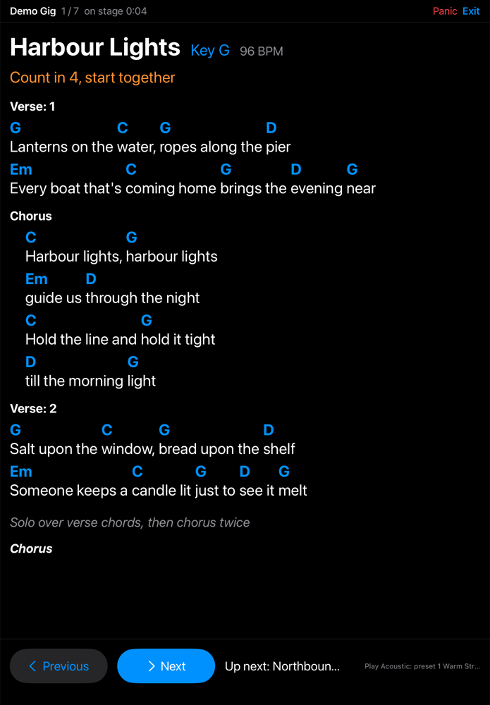
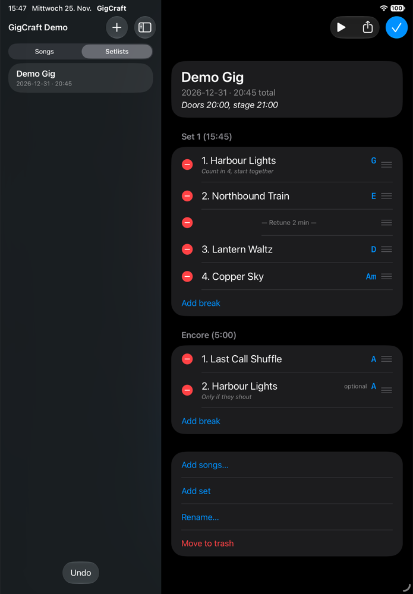
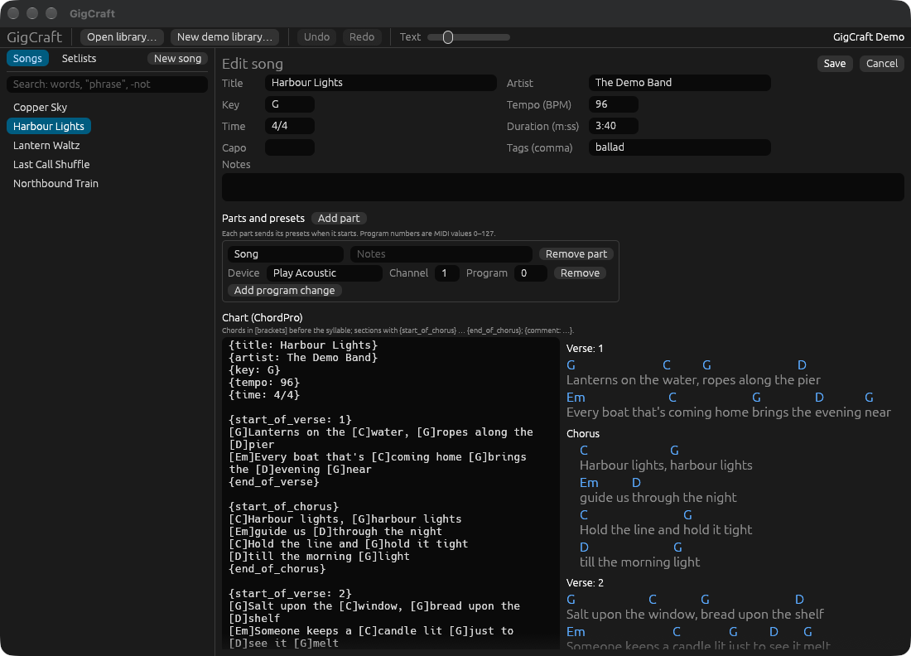

# GigCraft

**An open-source app for gigging musicians and bands:** setlists, chord charts and PDFs, backing tracks and click, MIDI preset control for your rig, band sync on stage, and gig organisation. On iPad, iPhone, Mac, Windows, Linux and in the browser. Offline, no account, your data in readable files.

> Status: **Phase 1 (solo on stage) – first complete version, not yet tested on a real gig.** Library, editors, setlists, perform mode with page turners and MIDI footswitches, pedal presets (TC-Helicon Play Acoustic, any MIDI device), PDF charts, import/export and folder sync work on the desktop and on iPad/iPhone. See the [roadmap](docs/plan/roadmap.md).

## Screenshots

*Current state (2026-11-25). Demo content: songs written for GigCraft.*

| Perform mode on iPad | Setlist editing on iPad |
|---|---|
|  |  |

| Perform mode on the desktop | Song editor with live preview |
|---|---|
|  |  |

| Setlist editor on the desktop | Song editor on iPad |
|---|---|
|  |  |

## What works today

- **Library** of songs (key, tempo, time, duration, capo, tags, notes, custom fields, links, attachments) as plain files; search with phrases and exclusions.
- **Charts** in ChordPro: chords above lyrics, sections, transposition, capo; PDF charts and images as attachments (PDFKit on iOS).
- **Setlists** with several sets, breaks, key/tempo/note per gig, optional songs, the same song twice, running times; share as text.
- **Perform mode**: big type, parts, gig notes, chart in the gig key, break countdown, "up next"; Bluetooth page turners and keyboards; MIDI footswitches via MIDI Learn; panic; screen stays on (iOS).
- **Rig**: song parts send presets to MIDI devices; the TC-Helicon Play Acoustic/Electric is driven by stepping with its own buttons when it ignores Program Change (read-only, never writes settings); a simulated pedal for rehearsing without hardware.
- **Import/export**: ChordPro, OnSong, OpenSong, chords-over-lyrics text, BandHelper TSV, CSV, Cuebook libraries, Ultimate Guitar links and playlists; ChordPro, TSV and setlist text out.
- **Sync** through any shared folder (iCloud Drive, Nextcloud, Syncthing): changes from other devices appear within seconds; conflicting saves are caught instead of overwriting.
- **Automation**: every action is a command – from the CLI, as MCP tools for AI agents, or from the apps. Undo/redo for everything; deleting moves to the library's trash.

GigCraft is an independent project. It follows the principles of the [ArtCraft](https://getartcraft.com/) Craft apps (Rust, local-first, every action scriptable from a CLI or an AI agent) and uses their open-source [craft-libs](https://github.com/storytold/craft-libs), but it is not an official ArtCraft app. It is not affiliated with BandHelper, Stage Traxx, OnSong or any other product named in the research notes.

## Try it

Requirements: Rust (installed via [rustup](https://rustup.rs); the version in `rust-toolchain.toml` is picked automatically). For the iOS app: Xcode 16+ and [XcodeGen](https://github.com/yonaskolb/XcodeGen).

```sh
# A library folder with demo songs and a setlist
cargo run -p gigcraft-cli -- init ~/GigCraft-Demo --demo

# Command line: every action is a command with JSON parameters
cargo run -p gigcraft-cli -- run -l ~/GigCraft-Demo --cmd 'song.list={"query":"ballad"}'
cargo run -p gigcraft-cli -- commands

# Desktop app (macOS, Windows, Linux)
cargo run -p gigcraft-desktop -- ~/GigCraft-Demo --song "Harbour Lights"
cargo run -p gigcraft-desktop -- ~/GigCraft-Demo --setlist "Demo Gig" --perform   # stage view
cargo run -p gigcraft-desktop -- ~/GigCraft-Demo --rig                            # MIDI devices

# MCP server for AI agents (stdio)
cargo run -p gigcraft-cli -- mcp -l ~/GigCraft-Demo

# iPad / iPhone app
cargo xtask apple                 # core as XCFramework + Swift bindings
cd apps/apple && xcodegen && open GigCraft.xcodeproj
```

For a device, copy `apps/apple/Config/Local.xcconfig.example` to `Local.xcconfig` and enter your team ID. On first start the app creates a demo library in its Documents folder (visible in the Files app).

A library is a plain folder: `songs/<name>/song.toml` + `chart.cho` (ChordPro), `setlists/<name>.toml`. Deleted items go to `.trash/`, nothing is ever hard-deleted.

## Development

```sh
cargo xtask ci        # format, clippy, tests, layering check
```

| Path | What |
|---|---|
| `crates/gigcraft-model` | data model: songs, parts, MIDI actions, setlists |
| `crates/gigcraft-chordpro` | ChordPro charts (parser: [ChordSketch](https://github.com/koedame/chordsketch), MIT) |
| `crates/gigcraft-store` | the library on disk, crash-safe saves, search |
| `crates/gigcraft-commands` | every action as a command, undo/redo, demo content |
| `crates/gigcraft-perform` | perform mode: running order, stage actions, keymap |
| `crates/gigcraft-midi` | MIDI parser, device profiles, Play Acoustic driver, MIDI Learn (no I/O) |
| `crates/gigcraft-rig` | presets → devices, MIDI input → actions, simulated pedal (no I/O) |
| `crates/gigcraft-formats` | import/export (ChordPro, OnSong, OpenSong, BandHelper TSV, CSV, Cuebook, Ultimate Guitar) |
| `crates/gigcraft-automation` | command lines and the MCP server |
| `crates/gigcraft-ffi` | the core for Swift (UniFFI) |
| `crates/gigcraft-ui-egui` | desktop/web interface |
| `apps/cli`, `apps/desktop`, `apps/apple` | the programs (desktop MIDI: midir; iOS MIDI: CoreMIDI) |
| `device-profiles/` | MIDI device profiles (TOML) – contributions welcome |
| `xtask` | build tasks |

See [CONTRIBUTING.md](CONTRIBUTING.md) for the clean-room and licence rules.

## Documents

| | |
|---|---|
| [Feature catalog](docs/plan/feature-catalog.md) | everything the app should do, by phase |
| [Roadmap](docs/plan/roadmap.md) | phases and work plan |
| [Architecture](docs/plan/architecture.md) | Rust core, native UIs, data format, sync |
| [Hosting](docs/plan/hosting.md) | where the project lives |
| [Decisions (ADRs)](docs/adr/) | recorded decisions |
| [Research](docs/research/) | BandHelper & landscape, Stage Traxx, ArtCraft, further tools & wishlist |

## License

Dual-licensed under [MIT](LICENSE-MIT) or [Apache-2.0](LICENSE-APACHE), at your option.
