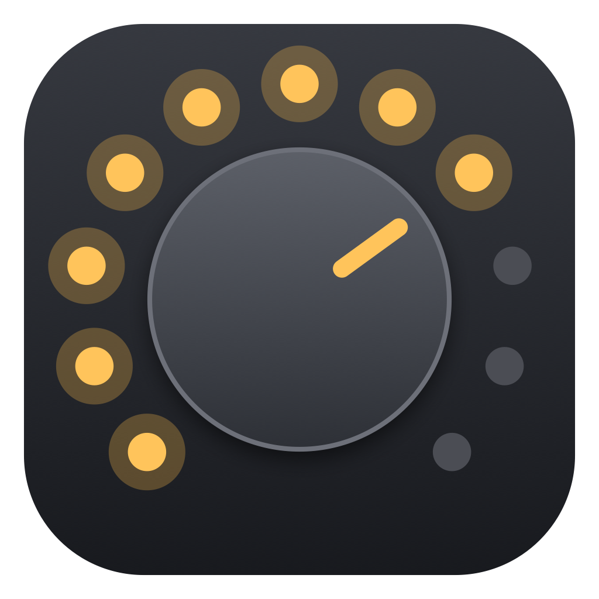

# GigCraft

**An open-source app for gigging musicians and bands:** setlists, chord charts and PDFs, backing tracks and click, MIDI preset control for your rig, band sync on stage, and gig organisation. On iPad, iPhone, Mac, Windows, Linux and in the browser. Offline, no account, your data in readable files.

> Status: **Phase 1 (solo on stage) done, Phase 2 (band on stage) under way – not yet tested on a real gig.** Library, editors, setlists, perform mode, pedal presets, PDF charts, import/export and folder sync on the desktop and iPad/iPhone; live sessions (the band follows on phones, tablets or other GigCraft apps), backing tracks with click on the desktop; English and German, with help and tooltips. See the [roadmap](docs/plan/roadmap.md).

## Screenshots

*Current state (2026-11-25). Demo content: songs written for GigCraft.*

| Perform mode on iPad | Setlist editing on iPad |
|---|---|
|  |  |

| Perform mode on the desktop | Song editor with live preview |
|---|---|
| 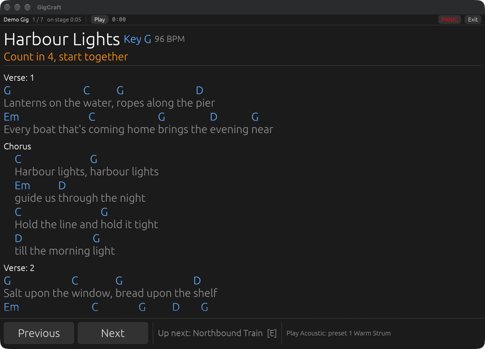 |  |

| Setlist editor on the desktop | Song editor on iPad |
|---|---|
| 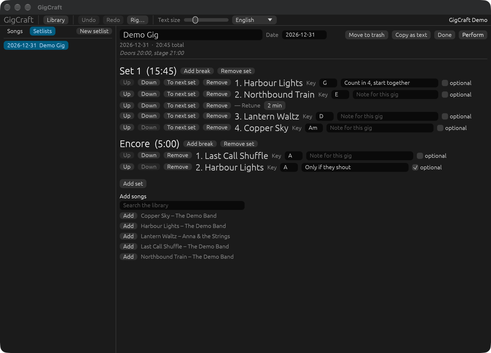 | 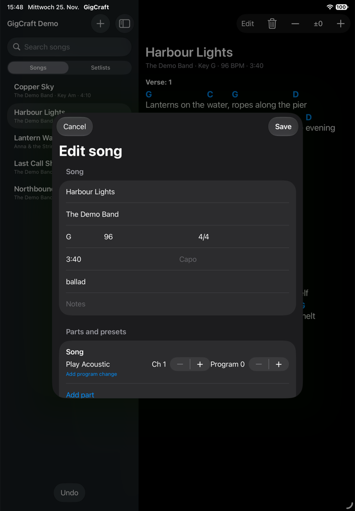 |

| Rig: MIDI devices, pedal status, MIDI Learn | |
|---|---|
| 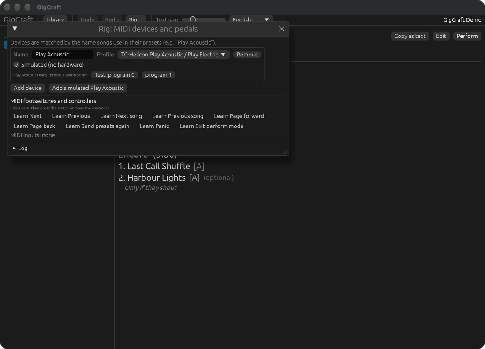 | |

| Live: the band follows on a phone (browser, no app) | Live: another GigCraft follows with its own chart |
|---|---|
| 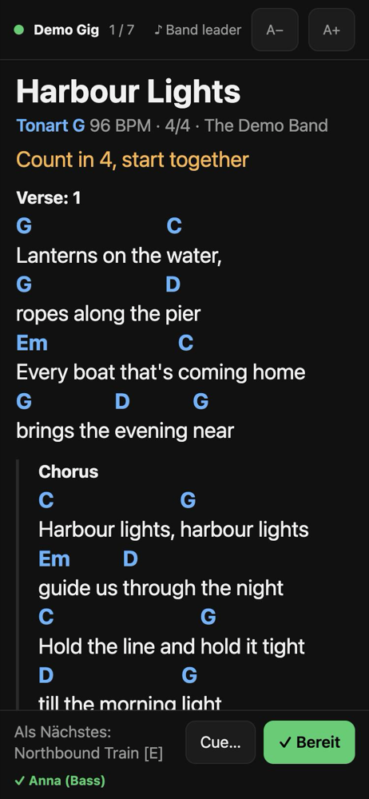 | 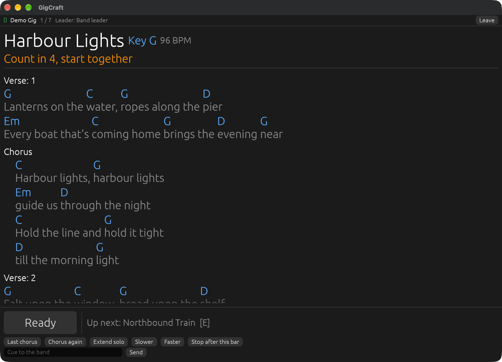 |

| Help (F1) and tooltips everywhere | Second screen: the chart follows the backing track |
|---|---|
| 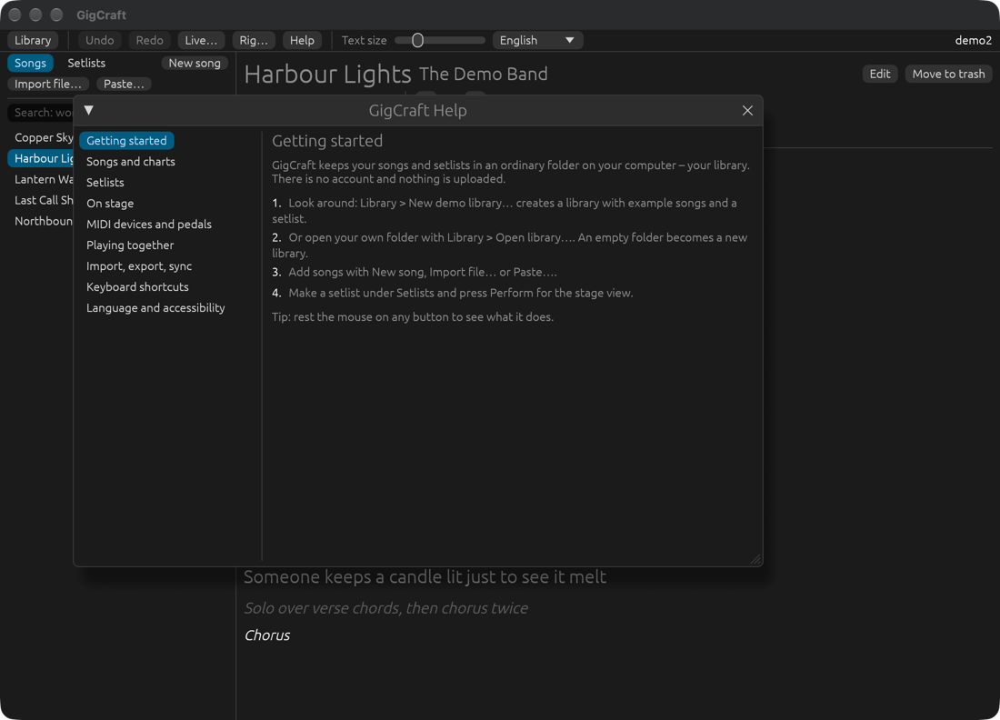 | 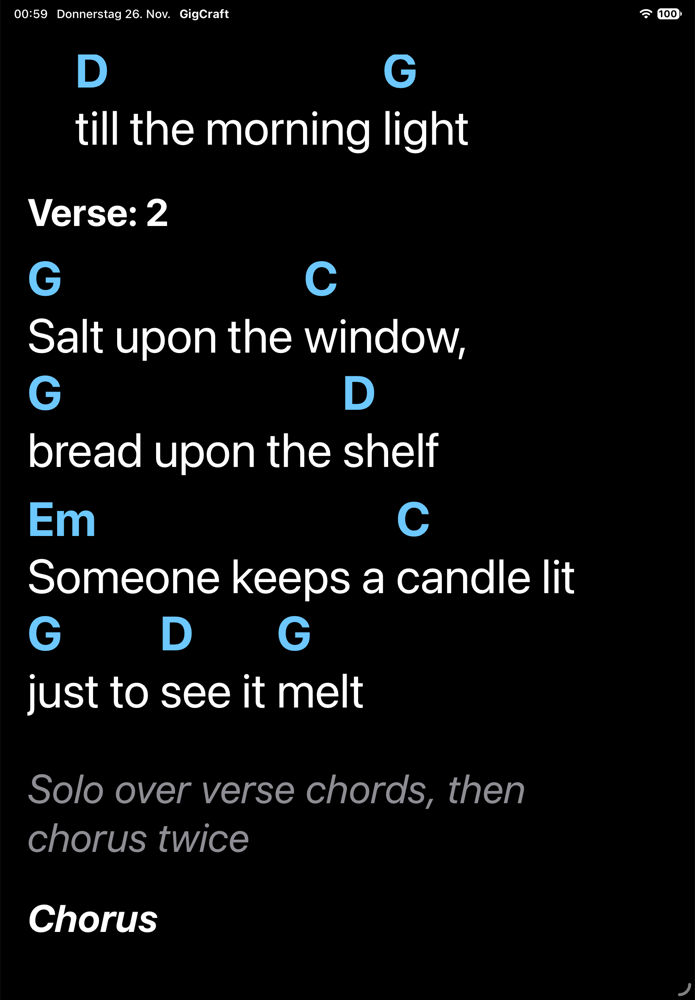 |

**Deutsch** – the interface follows the system language, or pick one in the app:

| Auftritt auf dem iPad | Setliste bearbeiten (Desktop) |
|---|---|
| 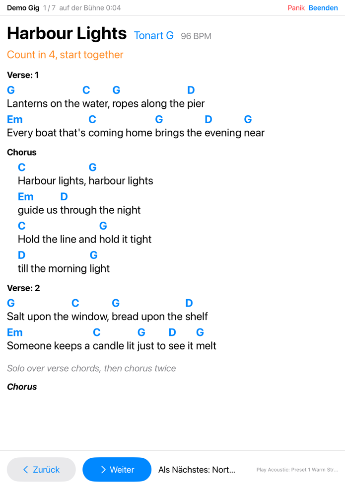 | 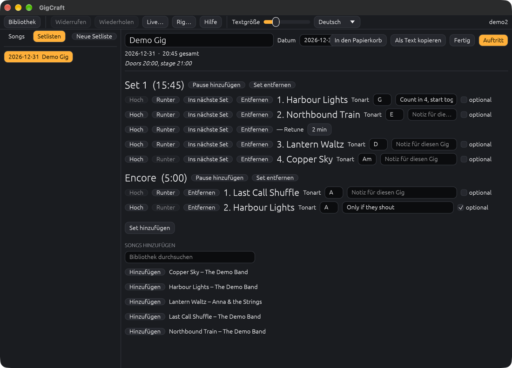 |

| iPad folgt dem Bandleader | Hilfe |
|---|---|
| 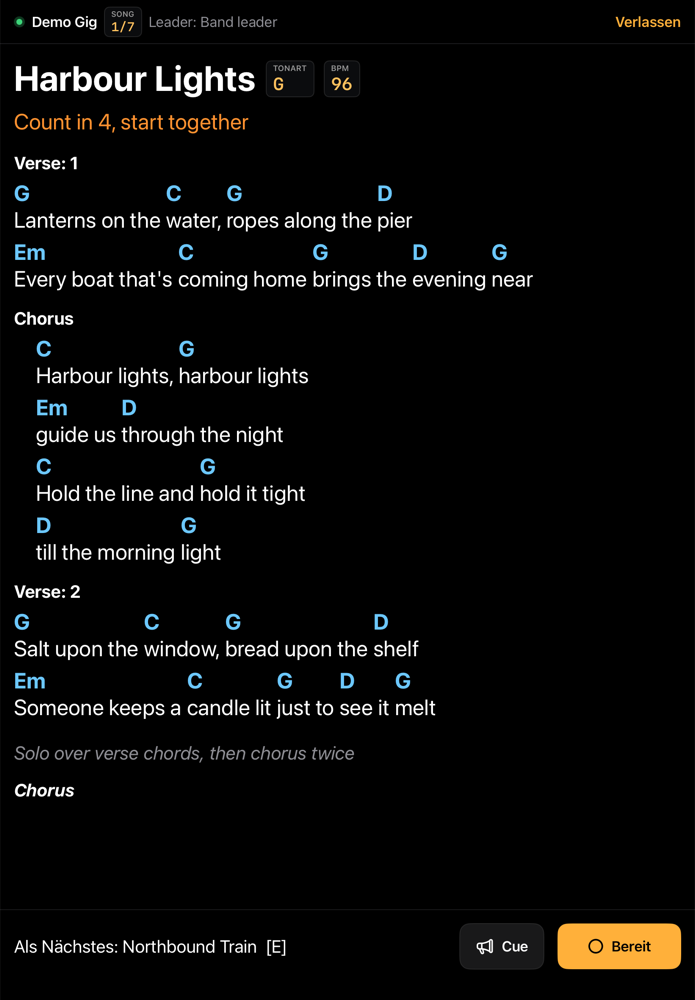 | 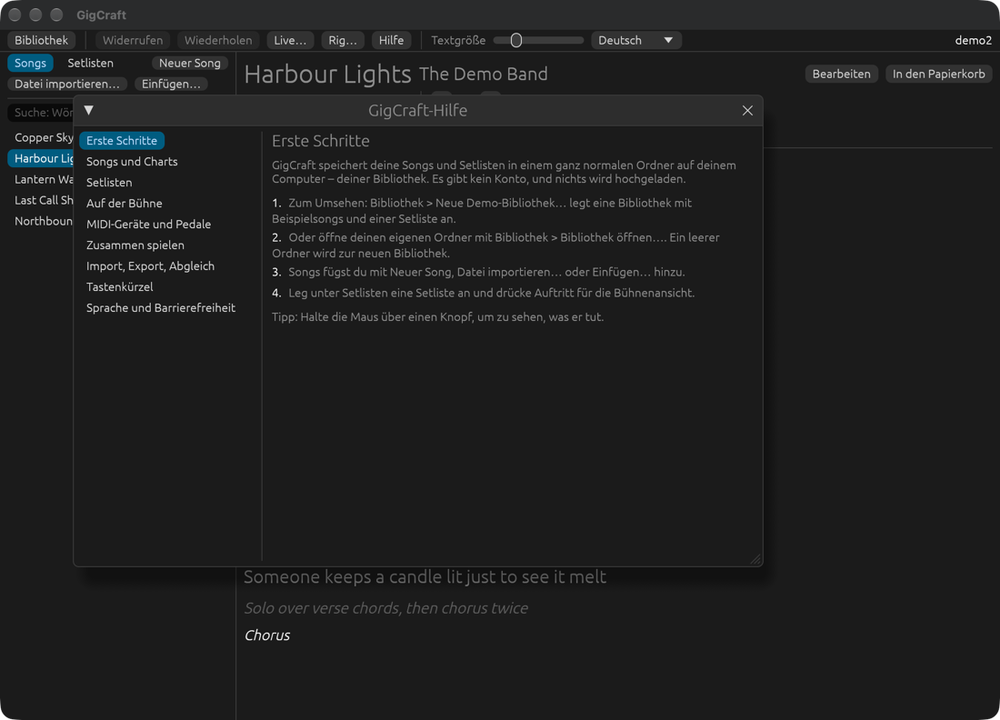 |

## What works today

- **Library** of songs (key, tempo, time, duration, capo, tags, notes, custom fields, links, attachments) as plain files; search with phrases and exclusions.
- **Charts** in ChordPro: chords above lyrics, sections, transposition, capo; PDF charts and images as attachments (PDFKit on iOS).
- **Setlists** with several sets, breaks, key/tempo/note per gig, optional songs, the same song twice, running times; share as text.
- **Perform mode**: big type, parts, gig notes, chart in the gig key, break countdown, "up next"; Bluetooth page turners and keyboards; MIDI footswitches via MIDI Learn; panic; screen stays on (iOS).
- **Rig**: song parts send presets to MIDI devices; MIDI clock at the song's tempo for delays, drum machines and loopers; the TC-Helicon Play Acoustic/Electric is driven by stepping with its own buttons when it ignores Program Change (read-only, never writes settings); a simulated pedal for rehearsing without hardware.
- **Import/export**: ChordPro, OnSong, OpenSong, chords-over-lyrics text, BandHelper TSV, CSV, Cuebook libraries, Ultimate Guitar links and playlists; ChordPro, TSV and setlist text out.
- **Sync** through any shared folder (iCloud Drive, Nextcloud, Syncthing): changes from other devices appear within seconds; conflicting saves are caught instead of overwriting.
- **Live sessions**: one device – computer, iPad or iPhone – leads the show; band members follow on the same Wi-Fi – in any browser via QR code, or in GigCraft (desktop, iPad, iPhone) with their own chart and their own pedal presets. Ready status and cues ("last chorus") for everyone. Nothing leaves the local network.
- **Backing tracks and click** (desktop, iPad, iPhone): audio files per song with volume, pan, mute and output pair (click to the in-ears on outputs 3/4), click with count-in, Play/Stop in perform mode; the next song loads in the background.
- **Look**: calm, modern surfaces with a light touch of stage gear – an amber LED accent, values like key, tempo and position in small display readouts, status lights; light and dark follow the system, the stage views are dark.
- **Second screen and following the track**: a window for a monitor or projector (desktop) or an external display (iPad, AirPlay/HDMI) shows the current song large, chart or lyrics only; with section start times the chart follows the backing track.
- **Help and tooltips**: a help window (F1) and a tooltip on every control on the desktop, a help sheet on iOS.
- **Languages and accessibility**: English and German (more languages are one catalog file each); screen readers on the desktop (AccessKit: VoiceOver, Narrator, Orca) and VoiceOver on iOS, where a chart line is read as one sentence with its chords after it; larger text sizes scale the charts.
- **Automation**: every action is a command – from the CLI, as MCP tools for AI agents, or from the apps. Undo/redo for everything; deleting moves to the library's trash.

GigCraft is an independent project. It follows the principles of the [ArtCraft](https://getartcraft.com/) Craft apps (Rust, local-first, every action scriptable from a CLI or an AI agent) and uses their open-source [craft-libs](https://github.com/storytold/craft-libs), but it is not an official ArtCraft app. It is not affiliated with BandHelper, Stage Traxx, OnSong or any other product named in the research notes.

## Download

Each version is on the [releases page](https://github.com/its-sven/gigcraft/releases) (latest builds of `main`: Actions → the newest run → Artifacts). See the [changelog](CHANGELOG.md).

| System | File | First start |
|---|---|---|
| macOS 11+ (Apple silicon and Intel) | `GigCraft-macOS-<version>.zip` | Unzip, move to Applications, then right-click → Open (the app is not notarized yet) |
| Windows 10/11 | `GigCraft-windows-x86_64-<version>.zip` | Unzip and start `gigcraft.exe`; SmartScreen: More info → Run anyway |
| Linux x86_64 | `GigCraft-linux-x86_64-<version>.tar.gz` | Unpack and run `./gigcraft` (`README.txt` shows how to add it to the menu) |
| iPhone, iPad (iOS 17+) | `GigCraft-<build>.ipa` | Install with SideStore or AltStore (see below) |

## Try it

Requirements: Rust (installed via [rustup](https://rustup.rs); the version in `rust-toolchain.toml` is picked automatically). For the iOS app: Xcode 16+ and [XcodeGen](https://github.com/yonaskolb/XcodeGen).

```sh
# A library folder with demo songs and a setlist
cargo run -p gigcraft-cli -- init ~/GigCraft-Demo --demo

# Command line: every action is a command with JSON parameters
cargo run -p gigcraft-cli -- run -l ~/GigCraft-Demo --cmd 'song.list={"query":"ballad"}'
cargo run -p gigcraft-cli -- commands

# Desktop app (macOS, Windows, Linux)
cargo run -p gigcraft-desktop -- ~/GigCraft-Demo --song "Harbour Lights"
cargo run -p gigcraft-desktop -- ~/GigCraft-Demo --setlist "Demo Gig" --perform   # stage view
cargo run -p gigcraft-desktop -- ~/GigCraft-Demo --rig                            # MIDI devices
cargo run -p gigcraft-desktop -- ~/GigCraft-Demo --lang de                        # in German
cargo run -p gigcraft-desktop -- ~/GigCraft-Demo --setlist "Demo Gig" --perform --live  # lead the band
cargo run -p gigcraft-desktop -- ~/GigCraft-Demo --join 192.168.1.20:8787         # follow a leader

# MCP server for AI agents (stdio)
cargo run -p gigcraft-cli -- mcp -l ~/GigCraft-Demo

# iPad / iPhone app
cargo xtask apple                 # core as XCFramework + Swift bindings
cd apps/apple && xcodegen && open GigCraft.xcodeproj
```

**iPhone and iPad without Xcode:** every push to `main` builds an unsigned `GigCraft-<build>.ipa` (GitHub → Actions → CI → the run → Artifacts; releases carry it too). Install it with [SideStore](https://sidestore.io) or [AltStore](https://altstore.io), which sign it with your own Apple ID; with a free Apple ID the app has to be refreshed every 7 days.

For a device from Xcode, copy `apps/apple/Config/Local.xcconfig.example` to `Local.xcconfig` and enter your team ID. On first start the app creates a demo library in its Documents folder (visible in the Files app).

A library is a plain folder: `songs/<name>/song.toml` + `chart.cho` (ChordPro), `setlists/<name>.toml`. Deleted items go to `.trash/`, nothing is ever hard-deleted.

## Development

```sh
cargo xtask ci        # format, clippy, tests, layering check
```

| Path | What |
|---|---|
| `crates/gigcraft-model` | data model: songs, parts, MIDI actions, setlists |
| `crates/gigcraft-chordpro` | ChordPro charts (parser: [ChordSketch](https://github.com/koedame/chordsketch), MIT) |
| `crates/gigcraft-store` | the library on disk, crash-safe saves, search |
| `crates/gigcraft-commands` | every action as a command, undo/redo, demo content |
| `crates/gigcraft-perform` | perform mode: running order, stage actions, keymap |
| `crates/gigcraft-midi` | MIDI parser, device profiles, Play Acoustic driver, MIDI Learn (no I/O) |
| `crates/gigcraft-rig` | presets → devices, MIDI input → actions, simulated pedal (no I/O) |
| `crates/gigcraft-live` | live sessions: protocol, leader and follower state (no I/O) |
| `crates/gigcraft-live-net` | live sessions on the LAN: WebSocket server and client, the band's web viewer, QR codes |
| `crates/gigcraft-audio` | backing-track engine: multitrack, buses, click/count-in, fades, regions (no I/O; [craft-audio](https://github.com/storytold/craft-libs) decoding) |
| `crates/gigcraft-audio-cpal` | desktop audio host: runs the engine on an output device ([cpal](https://github.com/RustAudio/cpal), Apache-2.0) |
| `crates/gigcraft-formats` | import/export (ChordPro, OnSong, OpenSong, BandHelper TSV, CSV, Cuebook, Ultimate Guitar) |
| `crates/gigcraft-automation` | command lines and the MCP server |
| `crates/gigcraft-ffi` | the core for Swift (UniFFI) |
| `crates/gigcraft-ui-egui` | desktop/web interface |
| `apps/cli`, `apps/desktop`, `apps/apple` | the programs (desktop MIDI: midir; iOS MIDI: CoreMIDI) |
| `device-profiles/` | MIDI device profiles (TOML) – contributions welcome |
| `xtask` | build tasks |

See [CONTRIBUTING.md](CONTRIBUTING.md) for the clean-room and licence rules.

## Documents

| | |
|---|---|
| [Feature catalog](docs/plan/feature-catalog.md) | everything the app should do, by phase |
| [Roadmap](docs/plan/roadmap.md) | phases and work plan |
| [Architecture](docs/plan/architecture.md) | Rust core, native UIs, data format, sync |
| [Hosting](docs/plan/hosting.md) | where the project lives |
| [Decisions (ADRs)](docs/adr/) | recorded decisions |
| [Research](docs/research/) | BandHelper & landscape, Stage Traxx, ArtCraft, further tools & wishlist |

## License

Dual-licensed under [MIT](LICENSE-MIT) or [Apache-2.0](LICENSE-APACHE), at your option.
